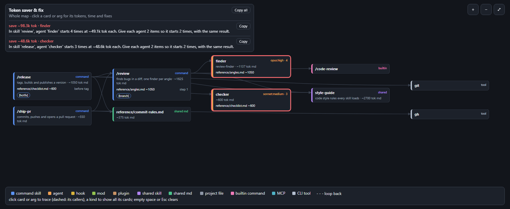

# skill-map

How does each Claude Code command branch out? `/skill-map` draws one zoomable page of every skill in `~/.claude/skills`,
plus your hooks, mods and plugins.

Each card shows what it pulls in: md files, sub-skills, agents, builtin commands, MCP servers and CLI tools.
Each link names its condition and argument.

The page also counts the tokens a run costs, and lists where you can save some.



## Install
1. Install Python 3.10 or newer (see [Python](#python) below).
2. In a terminal:
   ```text
   claude plugin install skill-map --marketplace BenBellborn/claude-code-monitor
   ```
   The marketplace is shared with [Claude Code Monitor](https://github.com/BenBellborn/claude-code-monitor).
   Already added it? Run `/plugin marketplace update claude-code-monitor` first.
3. Start a new session and type `/skill-map`.

## Usage
- `/skill-map`: reads only the skills that changed since the last map, draws the page and opens it in your browser.
- `/skill-map full`: reads every skill again.
- Full command name: `/skill-map:skill-map`. The short `/skill-map` works when no other command has that name.

## What the page shows
- **Columns:** command skills on the left; then agents, hooks, mods, plugins, shared skills, md files, project files,
  builtin commands, MCP servers and CLI tools.
- **Layout:** linked cards pull close to each other. Short columns stack under others, so most edges run left to right.
- **Cards:** a skill's own md files with their token size, and its arguments as buttons.
- **Agent cards:** model, effort and how many agents start.
- **Click a card or an argument:** only that flow stays lit; the cards that call it show dashed.
- **Flow totals:** after a click, the top-left card shows tokens, estimated time and fixes for that flow alone.
- **Click a kind in the legend:** every card of that kind is lit.
- **Savings card:** the top 5 token savings, and every fault found.
- **Faults:** a missing md file, a hook script that is gone, an MCP server not set up.
- **Prompts:** each saving or fault has a prompt to copy into Claude.
- **Zoom and pan:** mouse wheel, drag, the `+` and `-` buttons, `0` to fit. `Esc` or a click on empty space clears a trace.

## How it works
1. A Python script scans `~/.claude` and lists each skill, hook, mod and plugin whose md files changed since the last map.
2. Sonnet agents read the changed units, 2 to 4 per agent. Each writes a JSON fragment to `~/.claude/cache/skill-map/skills/`.
3. The script checks each fragment, lays out the map and writes `~/.claude/cache/skill-map/skill-map.html`.
4. A verifier agent checks each token-saving hint against the skill's own md files before the page shows it.

The skill never edits your skills. The first run reads every skill, so it costs the most; later runs read only what changed.

## Needs
- Claude Code with plugin support.
- Python 3.10 or newer on `PATH` as `python`. No packages to install.
- A browser. The page is one HTML file with no network access.

## Python
Check with `python --version`.
- Windows: `winget install -e --id Python.Python.3.12 --scope user`.
- Windows, `python` opens the Microsoft Store: turn off the `python.exe` and `python3.exe` aliases.
  Path: Settings > Apps > Advanced app settings > App execution aliases.
- Mac: `brew install python`, or the installer from python.org. If only `python3` exists, add `alias python=python3`.
- Linux: the distro package, for example `sudo apt install python3 python-is-python3`.

## Development
- Tests: `python -m pytest -q skills/skill-map/scripts`.
- Demo picture: `python docs/demo.py <work folder>` builds a map from a made-up skill set. Take the picture with a
  headless browser:
  `msedge --headless --window-size=1560,640 --screenshot=docs/demo.png <work folder>/cache/skill-map.html`.
- Local install from a clone: `claude plugin marketplace add <clone folder>`, then `claude plugin install skill-map@skill-map`.
- `skills/skill-map/SPEC.md` describes every rule of the scan, the fragment format, the layout and the page.

## Remove
`claude plugin uninstall skill-map`. The cache stays in `~/.claude/cache/skill-map/`; delete that folder too if you want.

## License
MIT, see [LICENSE](LICENSE).
